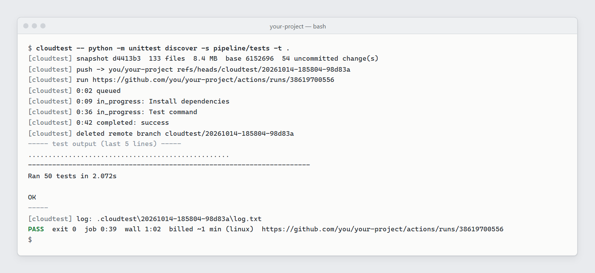

# cloudtest

Run a CPU-heavy test command on a **GitHub Actions hosted runner** instead of your own
machine. The runner gets an exact snapshot of your working tree, including uncommitted and
untracked files, and your local repo state (index, HEAD, branches, stash) is never touched.

> **Warning: cloudtest publishes your working tree to the target repo.** Every run pushes a snapshot of your current
> working tree, including uncommitted and untracked (not gitignored) files, as a commit on a `cloudtest/*` branch of
> the repo's own `origin` on GitHub. On a **public** repo, anyone can see that snapshot commit, the full run log (your
> test command, its output, and any `--env` values, which are written into the injected workflow file), and any
> uploaded artifacts. Deleting the branch afterwards does not hide them. The commit stays reachable by its SHA, the
> run and its log stay in the Actions tab until you delete the run, and artifacts stay downloadable until they
> expire. cloudtest refuses public repos unless you pass `--allow-public`. Only pass it from a tree that holds nothing
> you would not publish.



*A real run, as cloudtest printed it: a Python unittest suite on a Linux runner. Only the repo name is replaced with `you/your-project`.*

```
cloudtest [options] -- <test command>
```

A finished run ends with one summary line, in this format:

```
PASS  exit 0  job 0:06  wall 0:28  billed ~1 min (linux)  https://github.com/<owner>/<repo>/actions/runs/<id>
```

## Why

A test suite that pins a small laptop for ten minutes (Electron end-to-end tests, headless
browser screenshot walks, simulations, backtests) can run on a 2-vCPU GitHub runner while the
laptop stays usable. GitHub Actions is already wired to the repo, already authenticated
through `gh`, and bills by the minute, so there is no server to rent or maintain. The hard
part is doing it **without committing anything**: you want to test what is on disk right
now, not what is on a branch. That is what cloudtest automates.

## Requirements

- **Node.js 18 or newer** (it uses only Node built-ins; developed and tested on Node 24).
- **git** on PATH.
- **GitHub CLI (`gh`)**, logged in (`gh auth login`) with the **`repo`** and **`workflow`**
  scopes. The `workflow` scope is needed because each snapshot commit contains
  `.github/workflows/cloudtest.yml`; GitHub rejects such a push over HTTPS without it. Add it
  with `gh auth refresh -s workflow`.
- A repo whose `origin` is on **github.com**, with **Actions enabled**. Private repos are
  the default; public repos need `--allow-public` (read the warning above).

## Install

```bash
git clone https://github.com/Owen-Silva/cloudtest.git
cd cloudtest
npm link          # puts `cloudtest` on PATH
```

Without npm, put the `bin/` folder on PATH instead: `bin/cloudtest` (bash, including Git
Bash on Windows) and `bin/cloudtest.cmd` (PowerShell / cmd) both call `cloudtest.js` next to
them. The bash shim sets `MSYS_NO_PATHCONV=1`, so on Git Bash arguments such as
`/etc/os-release` reach the runner unchanged.

Check it with `npm test` (an offline smoke test: help, recipe loading, the deny-list
guard; it never contacts GitHub).

## Configure

Everything personal stays **outside** the tracked files, so a `git pull` never touches it and
it can never be committed by accident (`.gitignore` covers both paths below).

- **Your recipes:** put them in `recipes.local/` next to `cloudtest.js`, or point
  `CLOUDTEST_RECIPES_DIR` at any folder. They are merged with the published examples in
  `recipes/`; a local recipe wins over a published one with the same name.
- **Your config:** `config.local.json` next to `cloudtest.js`, or the file named by
  `CLOUDTEST_CONFIG`. Today it holds one setting, the **deny list**:

  ```json
  { "denyRepos": ["your-name/prod-site", "your-name/infra"] }
  ```

  cloudtest refuses to push to these repos unless you pass `--allow-deploy-repo`. Use it for
  any repo where a push to *any* branch can trigger a deploy. `CLOUDTEST_DENY_REPOS`
  (comma-separated) adds to the list. A config file that exists but cannot be parsed, or a
  `CLOUDTEST_CONFIG` that points at a missing file, is an error: the guard fails closed
  rather than silently running with no deny list.

## Examples

```bash
cloudtest -- npm test
cloudtest -- "npm run build && npm run e2e"                  # one argument = shell string
cloudtest --artifacts "test-results/**,screenshots/*.png" -- npx playwright test
cloudtest --display -- npm run test:electron                 # xvfb (automatic if electron is a dependency)
cloudtest --python 3.12 --setup "pip install -e ." -- pytest -q
cloudtest --include data/cache -- python scripts/backtest.py # bring a gitignored data folder along
cloudtest --os windows -- "npm test"                          # bills 2x
cloudtest --dry-run -- npm test                              # show what would happen, push nothing
cloudtest --cleanup                                          # delete leftover cloudtest/* branches
cloudtest --recipes                                          # list recipes
cloudtest --recipe my-e2e                                    # run a saved recipe (see "Recipes")
cloudtest --recipe my-e2e --timeout 20 -- "npm run test:unit"   # recipe setup, other command
cloudtest --env CI=1 -- npm test                             # env var for the setup and test steps
```

## Options

| option | meaning |
|---|---|
| `--os linux\|windows` | runner OS. Default `linux` (ubuntu-latest). `windows` = windows-latest, bills 2x |
| `--setup "<cmd>"` | extra setup, runs after the automatic dependency install |
| `--artifacts "<glob>"` | files to bring back. Repeatable, or comma-separated. Kept 1 day on GitHub |
| `--node <ver>` | Node version. Auto `lts/*` (or `.nvmrc` / `.node-version`) when `package.json` exists |
| `--python <ver>` | Python version. Auto `3.12` (or `.python-version`) when `requirements.txt` / `pyproject.toml` exists |
| `--timeout <min>` | job timeout, default 30 (1 to 360) |
| `--fetch-depth <n>` | git history in the checkout. Default 1 (shallow). `0` = full history, for tests that `git show <old sha>:file` |
| `--display` / `--no-display` | force / disable the `xvfb-run -a` wrapper on Linux. Auto-on when `electron` is in package.json deps |
| `--no-install` | skip the automatic `npm ci` / `npm install` / `pip install -r requirements.txt` |
| `--shell bash\|pwsh` | shell for the command. Default bash on both OSes (Git Bash on Windows) |
| `--include <path>` | force-add a **gitignored** path into the snapshot (repeatable, relative to the repo root). See below |
| `--recipe <name>` | load `<name>.json` from your local recipes dir or `recipes/` (see "Recipes"). Flags beat recipe fields; a command after `--` beats the recipe's command |
| `--recipes` | list the recipes with their description and `verified` line (works anywhere, no repo needed) |
| `--env KEY=VAL` | env var for the setup-file, setup and test steps (repeatable). Beats the recipe's `env` per key. Values of secret-looking keys are never printed (see below) |
| `--dry-run` | build the snapshot; print file count, size, the injected workflow and the push target. Pushes nothing |
| `--cleanup` | only sweep leftover `cloudtest/*` branches (see "Interrupts") |
| `--allow-deploy-repo` | permit a repo on your deny list (see "Configure"; refused by default) |
| `--allow-public` | permit a public repo (refused by default: the snapshot, log and artifacts would be public) |

If you give exactly one argument after `--`, it is used as a shell string. If you give
several, each one is quoted, so argv is preserved (`cloudtest -- npm test -- --grep "a b"`).

## How it works, and why it is built this way

1. **Snapshot without touching your repo.** cloudtest copies `.git/index` to a temp file and
   points `GIT_INDEX_FILE` at it. It then runs `git add -A` (plus `git add -f` for each
   `--include`), `git write-tree`, and `git commit-tree -p HEAD`, with the author and
   committer set through env vars. Your real index, HEAD, branches, stash and working files
   are never written. The only side effects are unreachable blob objects in `.git/objects`,
   which `git gc` cleans up, and a one-time `/.cloudtest/` line in `.git/info/exclude`.
   *Why:* `git stash` or a temporary commit would race with whatever else is editing the
   tree (an editor, another terminal, a coding agent). A private index cannot.
2. **Inject the job.** In the snapshot only, it adds `.github/workflows/cloudtest.yml` and
   `.cloudtest-job/` (the command, setup, install and wrapper scripts, plus `options.json`),
   and it removes every other file under `.github/workflows/`. *Why:* the repo needs no
   setup at all, its own CI never fires, and the workflow never lands on a real branch.
3. **Push a throwaway branch.** It pushes the commit to
   `refs/heads/cloudtest/<UTC timestamp>-<random>` with `--no-follow-tags
   --recurse-submodules=no`. The push goes to the origin URL, not the remote name, so no
   local remote-tracking ref is created. `gh`'s token is the credential, so no credential
   manager window opens. *Why:* a unique branch per run lets several runs go in parallel.
4. **Watch.** It finds the run, then polls it every 5 s and prints one short line each time
   the status or step changes.
5. **Collect and clean up.** It deletes the remote branch as soon as the run completes. It
   then saves the job log to `.cloudtest/<id>/log.txt`, prints the last 40 lines of the
   **test step's** output, and downloads artifacts to `.cloudtest/<id>/artifacts/`.
   `.cloudtest/<id>/run.json` holds the run URL, the snapshot sha, the exit code and the
   billed minutes.
6. **Exit with the test's own code.** The exit code is read from a marker the wrapper prints
   into the log, so `cloudtest -- npm test && deploy` behaves like the local command. If
   cloudtest itself fails (refusal, push error, no run appeared), it exits **125**.

Workflow steps: checkout, then setup-node / setup-python when needed, then the dependency
install (`npm ci` with a lockfile, else `npm install`; pnpm/yarn through corepack;
`pip install -r requirements.txt`), then xvfb on Linux (installed if missing, and the
AppArmor userns rule relaxed so the Electron/Chromium sandbox starts on Ubuntu 24.04), then
a recipe's `setupFile`, then `--setup`, then the test command, then `upload-artifact` with
`if: always()` and `retention-days: 1`. Dependency caches are off on purpose: a cache saved on
one `cloudtest/*` branch cannot be restored by the next one.

The tool is one file with no npm dependencies, so there is nothing to install or audit
beyond Node, git and `gh`.

## Recipes

A recipe is a saved, proven set of options for one repo, stored as `<name>.json` in your
local recipes dir (`recipes.local/` or `CLOUDTEST_RECIPES_DIR`). `recipes/` holds a published
example, `example-node-playwright.json`; copy it into `recipes.local/`, rename it and set
`repo`. Check `cloudtest --recipes` before building a command by hand.

```json
{ "description": "...", "repo": "<owner>/<repo>", "os": "linux|windows", "node": "22", "python": "3.13",
  "setup": "<shell cmd>", "setupFile": "<.ps1 or .sh file next to the recipe>",
  "include": ["data/cache"], "artifacts": "<glob>", "timeout": 60, "env": { "CI": "1" },
  "command": "<test command>", "verified": "<date, run URL, billed minutes, result>" }
```

- Only `repo` and `command` are required. `include` and `artifacts` take a string (comma
  separated) or an array. Write versions as strings (`"3.10"`, not `3.10`).
  Optional extras: `shell` (`bash`/`pwsh`), `install` (`false` = `--no-install`), `display` (true/false),
  `fetchDepth` (number, `0` = full history).
  Unknown fields get a warning and are ignored; fields starting with `_` are ignored silently (use them for notes).
- **Precedence:** a flag on the command line beats the recipe field. A command after `--`
  beats the recipe's `command`. `--include` / `--artifacts` given on the command line
  **replace** the recipe's list. `--env KEY=VAL` beats the recipe's `env.KEY`, and other keys are kept.
- **Repo check:** the recipe is refused unless `repo` matches this repo's origin
  (case-insensitive). The deny-list and public-repo refusals still run first.
- **`setupFile`** is a file in the same folder as the recipe (a bare name, `.ps1` or `.sh`).
  It is copied into the snapshot as `.cloudtest/setup.<ext>` and runs as its own step after
  the dependency install, before `setup`: `.ps1` with
  `pwsh -NoProfile -NonInteractive -ExecutionPolicy Bypass -File`, `.sh` with `bash`. Its
  working directory is the checkout root. A non-zero exit fails the run before the test starts.
- **`env`** (and `--env`) become step env for the setup-file, setup and test steps (not the
  dependency install). Names must match `[A-Za-z_][A-Za-z0-9_]*`. `GITHUB_*`, `RUNNER_*`,
  `ACTIONS_*` and `CLOUDTEST` are refused. Values must be one line.
- **Secret-looking keys** (the name contains token, key, secret, passw, pwd, auth, credential,
  cookie, session, private, signature, salt or cert) have their value shown as `***` everywhere
  cloudtest prints or saves: the summary, the dry-run workflow, `options.json` and the saved
  `log.txt`. The real value is still in the pushed workflow file, so do not use this for real secrets.
- `verified` is free text. Fill it in only after a real run: the date, the run URL, the billed
  minutes and the result from the test's own summary line.

## Minutes and billing

- Check your plan's included Actions minutes at github.com/settings/billing. Private-repo
  minutes are metered; public repos are free (but see the warning at the top).
- Each job is rounded **up to a whole minute**. A 6-second job bills 1 minute.
- **Windows bills 2x**: a 21-second Windows job bills 2 minutes. macOS is not offered.
- The summary line shows an estimate (`billed ~N min`), computed from job start and end
  times. For the real numbers, see your billing page.
- Artifacts count against Actions storage. cloudtest keeps them for 1 day only.

## What can NOT go to the cloud

- Anything that needs **your desktop**: your screen, a real GPU, a logged-in desktop
  session, apps running on your machine, or on-screen checks.
- **Your browser profile**: cookies, logins, extensions, and sites that block datacenter IPs
  or automated browsers.
- **Devices and private networks**: phones, USB hardware, VPN-only or LAN services.
- **Secrets**: `.env` files are normally gitignored, so they are not in the snapshot, and
  cloudtest adds no secrets to GitHub. Tests that need API keys or database passwords will
  fail or must be skipped in the cloud. Do not put secrets on the command line: it is stored
  in the pushed snapshot.
- Local services (a local database, a local model server) and large ignored data, except
  what you bring with `--include` (200 MB limit).
- Real-money or real-account actions. Never point a cloud run at a production account.

## --include (gitignored data)

`--include data/cache` adds every untracked file under that path, ignored or not, using
`git add -f` into the temp index. This is for harnesses that read a cached dataset you keep
out of git. The path is relative to the repo root, and globs follow git pathspec rules.
Hard refusals:

- any file whose name starts with `.env`, ends with `.pem` or `.key`, or contains `secret`,
  `token` or `credential` (case-insensitive). These rules have no exceptions, so
  `.env.example` and `tokenizer.json` are refused too. Narrow the path if that happens
- any single file over 50 MB
- a snapshot over 200 MB in total
- a path that does not exist, is outside the repo, or is `.git` / `.cloudtest`

## Safety rules (enforced in code)

- **Deny-listed repos are refused** (see "Configure"), checked against the origin fetch URL,
  the push URL and the canonical GitHub name (this catches renames). Override with
  `--allow-deploy-repo`. Branch-push integrations (Vercel or Netlify previews, branch
  deploys) can react to **any** branch push, so deny-list every repo that has them.
- **Only `refs/heads/cloudtest/*` is ever pushed.** The push function asserts the refspec;
  it never force-pushes and never pushes tags or submodules.
- **Branches are deleted** right after the run completes, and also on errors and Ctrl-C
  (best effort). The workflow **run and its log are not deleted**; they follow the repo's log
  retention.
- **Secrets**: the tool refuses a snapshot that contains uncommitted secret-looking files
  (`.env`, `.env.*` except example/sample/template, `*.pem`, `*.key`, `id_rsa*`,
  `credentials.json`, `.npmrc` and so on). Logs and errors are scrubbed of token
  patterns. The workflow gets `permissions: contents: read` and
  `persist-credentials: false`, and references no repo secrets.
- **Size**: the tool refuses any file over 50 MB, and any snapshot over 200 MB in total.
- **Public repos are refused** unless you pass `--allow-public`.
- The repo's **pre-push hook still runs** on the push. cloudtest does not skip hooks. If a
  hook runs the test suite locally, it defeats the purpose, so disable it for that repo yourself.

## Interrupts and leftovers

On Ctrl-C (SIGINT/SIGTERM), cloudtest cancels the run and deletes the branch. If the process
is **hard-killed** (Task Manager, `kill -9`, a tool timeout), no handler runs. The branch
stays behind, and the cloud job keeps going until it ends or hits `--timeout`. The next
cloudtest run in that repo sweeps leftovers first. `cloudtest --cleanup` sweeps only. A sweep
deletes a `cloudtest/*` branch that is over 3 minutes old and whose runs have all completed.
Live runs from parallel calls are left alone.

## Known limits

- Submodules are not checked out. LFS is fetched only when `.gitattributes` uses `filter=lfs`.
- `pyproject.toml` without `requirements.txt` is not auto-installed. Use `--setup "pip install -e ."`.
- Each run is a fresh machine, so there is no dependency cache. `npm ci` on a big Electron
  project adds about 1 minute.
- The billed-minutes figure is an estimate from job start and end times, rounded up per job.
- The pushed snapshot objects stay reachable on GitHub by sha until GitHub garbage-collects
  them. That is one more reason never to snapshot secrets (the refusal rules above cover this).
- GitHub Actions are referenced by tag (`@v7`), not pinned to a commit SHA.

## Licence

MIT. See [LICENSE](LICENSE).

## Contributing

Issues welcome; pull requests are not accepted right now.
